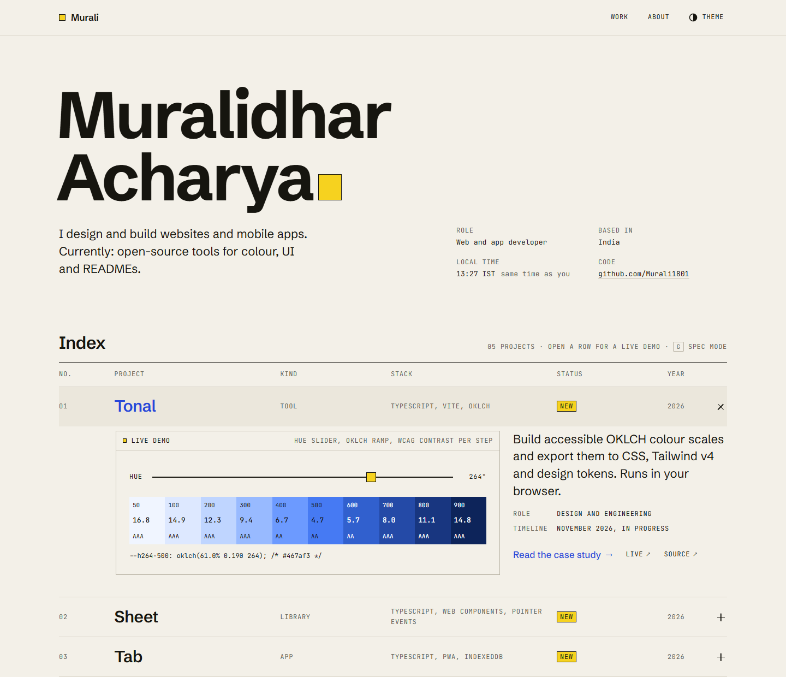
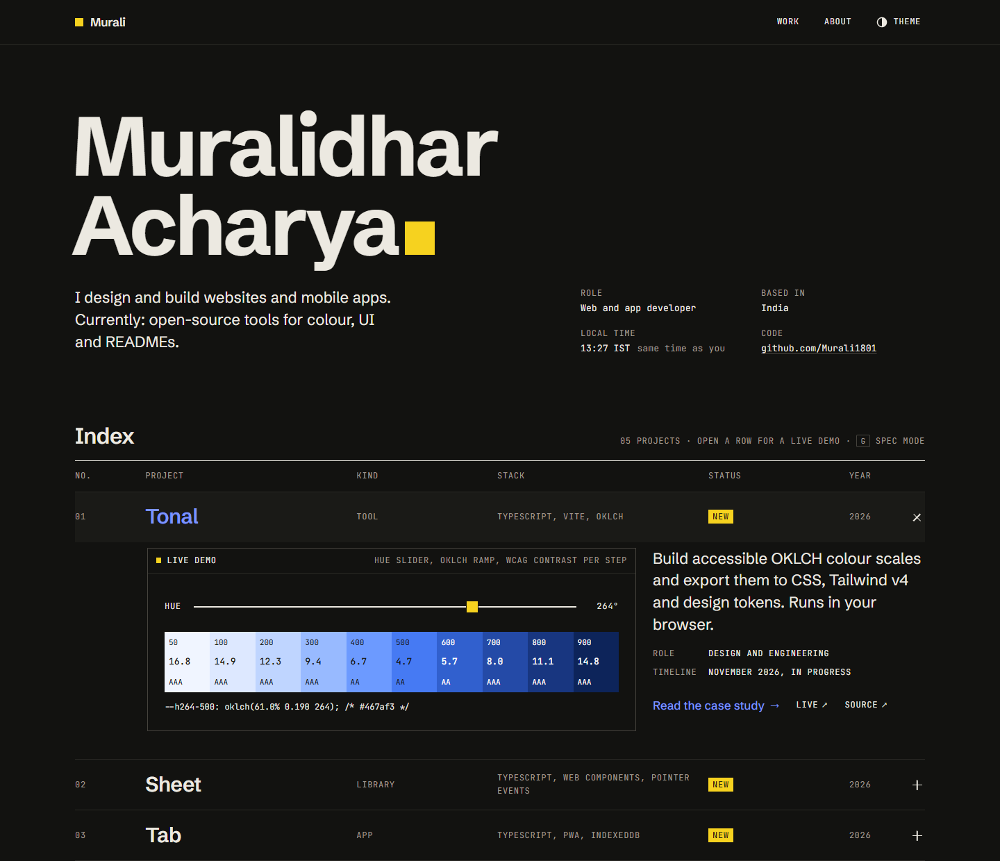

<picture>
  <source media="(prefers-color-scheme: dark)" srcset="docs/screenshot-dark.png">
  
</picture>

# Portfolio

**A case-study-first portfolio template for developers who ship things. Astro, zero JS by default.**

Live demo: https://portfolio.vercel.app <!-- TODO: replace after the first deploy -->

[](https://vercel.com/new/clone?repository-url=https://github.com/Murali1801/portfolio)
[](https://app.netlify.com/start/deploy?repository=https://github.com/Murali1801/portfolio)

| Light | Dark |
|---|---|
|  |  |

## Quick start

```bash
git clone https://github.com/Murali1801/portfolio my-portfolio
cd my-portfolio
npm install
npm run dev        # http://localhost:4321
```

Node 22.23 or newer. `npm run build` type-checks and writes a static site to `dist/`. `npm test` runs the unit tests.

## Customise in 5 minutes

- [ ] **`site.config.ts`**: your name, role, one-line intro, time zone, GitHub user, email and the about block.
- [ ] **`src/styles/theme.css`**: colours (light and dark), fonts, type scale, grid and motion. Every style in the template reads these tokens.
- [ ] **`src/content/projects/*.md`**: one Markdown file per project. Delete the five examples and write your own. The frontmatter is typed, so a missing field fails the build with a clear message.
- [ ] **`public/avatar.png`**: your picture, or set `avatar: null` in the config.
- [ ] **`public/og.png`** and **`public/favicon.svg`**: the link preview and the icon. `scripts/og.html` is the source of the preview image.

A project file looks like this:

```md
---
title: Tonal
order: 1
kind: tool            # tool | library | app | template | site | client
stack: [TypeScript, Vite, OKLCH]
year: 2026
summary: One line for the index and the case-study lede.
repo: tonal           # optional: star count + source link
live: https://...     # optional: defaults to https://<repo>.vercel.app, false hides it
role: Design and engineering
timeline: November 2026, in progress
demo: tonal           # optional: a live demo from src/demos, or none
---

## The problem
Write the case study in plain Markdown.
```

## Features

- **Project index as the home page.** `No. / Project / Kind / Stack / Status / Year`. Each row is a button that expands in place (CSS `grid-template-rows` 0fr to 1fr, 220 ms) into a live demo, the summary and links.
- **Live demos as islands.** A demo's code is fetched the first time its row opens, or when a case study's demo scrolls into view. Pages ship no demo code before that.
- **Spec mode.** Press <kbd>G</kbd> on any page, or use the footer toggle, to draw the 12-column grid and 8 px baseline over the layout.
- **Case-study pages** at `/work/<slug>`: a 680 px text column, full-bleed media breaks, a mono facts strip (role, stack, timeline, status, links) and no sticky table of contents.
- **Real GitHub star counts**, fetched once at build time and printed as text. Offline, rate-limited or for a repo that does not exist yet, the row says `new` and the build carries on. Set `GITHUB_TOKEN` to raise the API limit.
- **Light and dark themes** from the system setting, with a toggle that remembers your choice and no flash on load.
- **Local clock** in your time zone, with the gap to the visitor ("5h 30m ahead of you").
- Sitemap, `robots.txt`, Open Graph image, SVG favicon, 404 page.
- Keyboard paths everywhere: rows are real buttons with `aria-expanded`, the sheet demo is a slider, focus is always visible, and reduced motion turns every transition off.

## How it compares

Star counts read from the GitHub API on 2026-11-15.

| Template | Stack | Focus | Stars |
|---|---|---|---|
| [bchiang7/v4](https://github.com/bchiang7/v4) | Gatsby, React | Experience list, then projects | 8,296 |
| [codewithsadee/vcard-personal-portfolio](https://github.com/codewithsadee/vcard-personal-portfolio) | HTML, CSS, JS | vCard-style single page, no build | 8,171 |
| [satnaing/astro-paper](https://github.com/satnaing/astro-paper) | Astro | Blog theme, accessibility, Lighthouse | 5,209 |
| [once-ui-system/magic-portfolio](https://github.com/once-ui-system/magic-portfolio) | Next.js, Once UI | Polished portfolio tied to its UI library | 1,427 |
| **This template** | Astro | Case studies first, live demos inside the index, two files to restyle | new |

Each of these is good at what it set out to do. Pick this one if your projects are things people can try, and you want the page to show them working rather than describe them.

## How it works

```
site.config.ts              your details, in one place
src/styles/theme.css        every colour, size and duration as a token
src/content.config.ts       the typed schema for projects
src/content/projects/*.md   one file per project
src/pages/index.astro       hero, index, about
src/pages/work/[slug].astro case-study layout
src/demos/*.ts              live demos, one small module each, loaded on demand
src/lib/*.ts                pure logic (colour maths, spring physics, settle-up, SVG, stars), unit tested
src/pages/media/[file].ts   case-study figures drawn at build time from src/lib
```

Astro renders every page to static HTML. The only scripts on a page are small ones for the clock, the theme toggle, the optional copy-email button, spec mode and the row toggle. Demo modules load through dynamic `import()` when they are needed. To add a demo, write `src/demos/<name>.ts` exporting `mount(el)`, register it in `src/demos/index.ts` and add the name to `DEMOS` in `src/content.config.ts`.

Star counts come from `https://api.github.com/repos/<user>/<repo>` with a 4 second timeout and a per-build cache. Any failure resolves to `null`, which prints as `new`.

## Contributing

Issues and pull requests are welcome. Keep the template small: one layout, two files to restyle, no new runtime dependencies without a strong reason.

```bash
npm test          # Vitest
npm run build     # astro check + astro build
```

## License

[MIT](LICENSE) © 2026 Muralidhar Acharya

---

Part of a set of tools by Murali: Tonal · Sheet · Tab · Masthead
